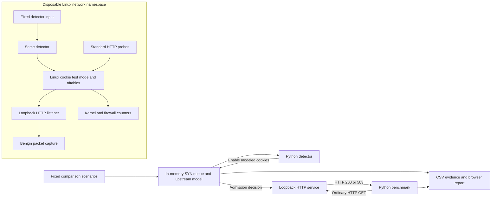

# Operator manual

## Architecture

The diagram guide walks through component responsibilities, detector timing, both recovery outcomes, and the Linux kernel check. [Project architecture and diagrams](docs/architecture.md)

The project uses an in-process model and a Python HTTP service for the comparison. The optional Linux check uses the same detector and a fresh namespace with only `lo`. Its fixed readings exercise the activation callback. Its network traffic consists of ordinary, complete HTTP requests.

## Present the demo

1. In a terminal, change to this directory. Run `python demo.py --kernel-check --pace 0.6`. Run `python demo.py --pace 0.6` for the model comparison and localhost benchmark alone.
2. Watch the baseline and both per-source firewall cases. A queue reading such as `32/32` is modeled occupancy. `200 x4` and `503 x0` are observed HTTP response counts for that window.
3. Find the alerts in the last two cases. The second elevated sample arrives in window 3. The defense applies starting in window 4.
4. Open the printed report. The recovery case serves every post-activation probe, even though the queue stays full. The upstream case serves one probe per window. Use the [walkthrough video](handoff/walkthrough.mp4) or the [browser screenshot](handoff/01-results.png) to present the saved run.
5. If the Linux check ran, show the `kernel-check.json`, `firewall-after.txt` and `handshakes.tsv` links. Open `benign-http.pcap` in Wireshark with the display filter `tcp.port == 18080`. Inspect a TCP stream for the initial SYN, SYN-ACK and final ACK. To show the HTTP messages, decode the port as HTTP if Wireshark has yet to infer the protocol.

## Configuration and reset

- `demo.py --out DIRECTORY` puts evidence in a new directory. Use a fresh path each time. Each case begins with its own empty queue and a fresh detector. Restart the demo to replay the full comparison.
- `demo.py --requests 100`, `--requests 250` and `--requests 500` increase the legitimate client probes per scenario. Probe counts are spread as evenly as possible across the same six windows. The modeled pressure stays fixed.
- `vm/run-vm.py --requests 250` runs the selected profile in a rebuilt Ubuntu VM and exports the guest report automatically. [VM setup and environment team guide](docs/environment-team.md)
- `demo.py --kernel-check` creates a new network namespace through `unshare`. It sets Linux cookie test mode after the fixture alert, restores the original cookie setting, and removes the dedicated firewall table. The namespace disappears when its processes exit.
- `firewall_rules.sh apply|status|reset [port]` installs, displays or removes the lab's scoped IPv4 nftables table inside the demo namespace. The kernel check runs these commands itself. The per-source meter is applied only to incoming initial SYNs for the demo port on loopback.
- `syn_defense_agent.py --port 18080 --threshold 20 --windows 2 --interval 1 --csv live-agent.csv` monitors Linux `SYN_RECV` in alert-only mode. Run it with a new CSV path and stop it with Ctrl+C. For a dedicated Linux environment where you intend to persistently enable normal overflow-mode SYN cookies at runtime, add `--enable-cookies`. The kernel demo manages its own temporary setting and restores it.
- `client_benchmark.py --port 18080 --requests 20 --interval 0.25 --csv client.csv` measures an existing loopback HTTP service at `/health`. The benchmark records status, outcome and elapsed time after reading the response body.
- `python generate_charts.py RUN_DIRECTORY` regenerates the report and summary from that run's CSV files.
- `python make_handoff.py RUN_DIRECTORY HANDOFF_DIRECTORY` rebuilds the browser screenshots, presentation and captioned video for a run with successful Linux verification. It uses Chromium, LibreOffice and FFmpeg.

## Troubleshooting

If socket creation or namespace setup returns `Operation not permitted`, run from a normal local Linux terminal where loopback sockets and user namespaces are available. If the core demo succeeds and the kernel check exits with an error, the report still contains the comparative results. Inspect `kernel-error.txt` in the run directory for the failing step.
