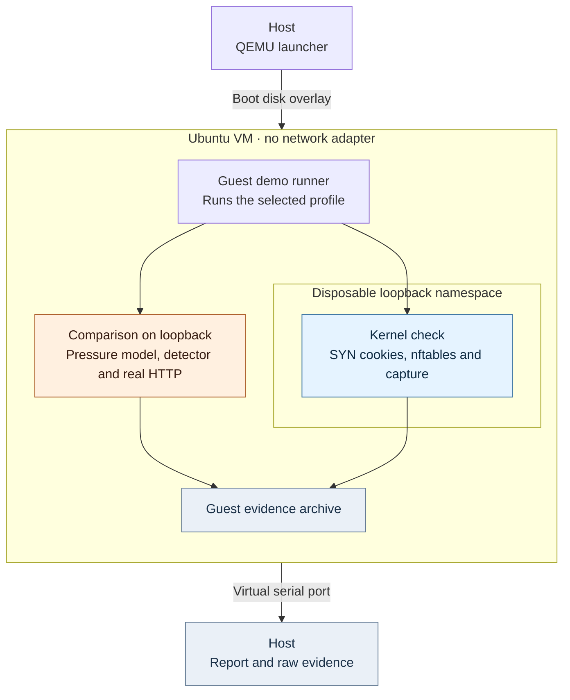
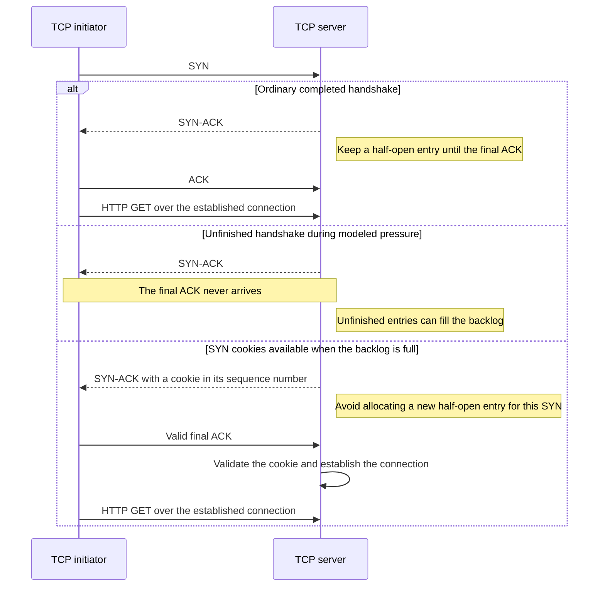
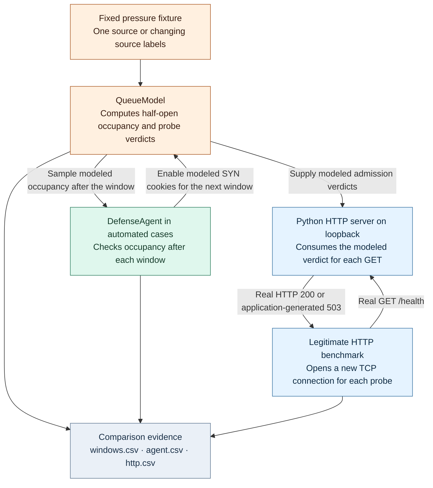
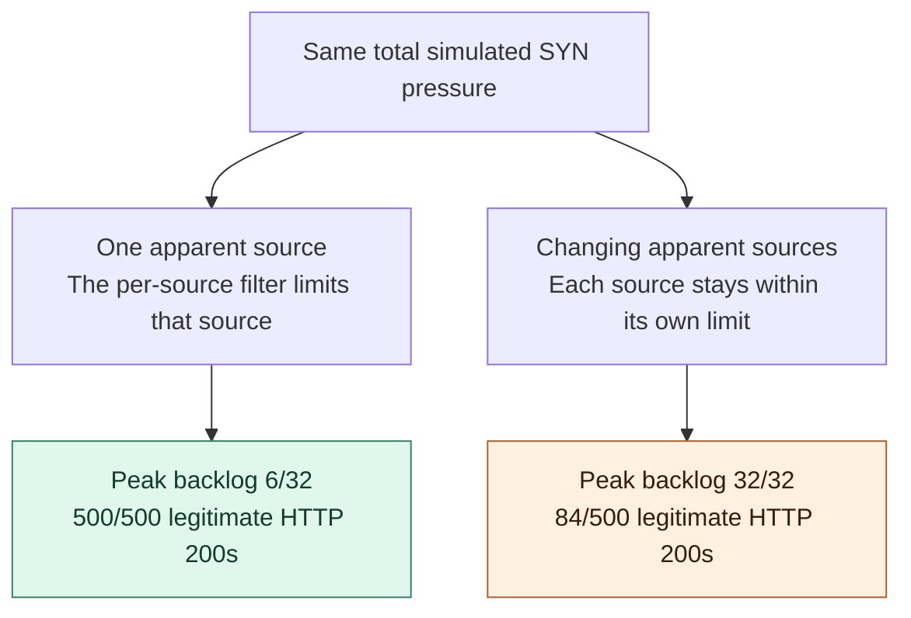
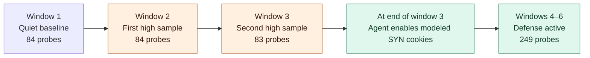
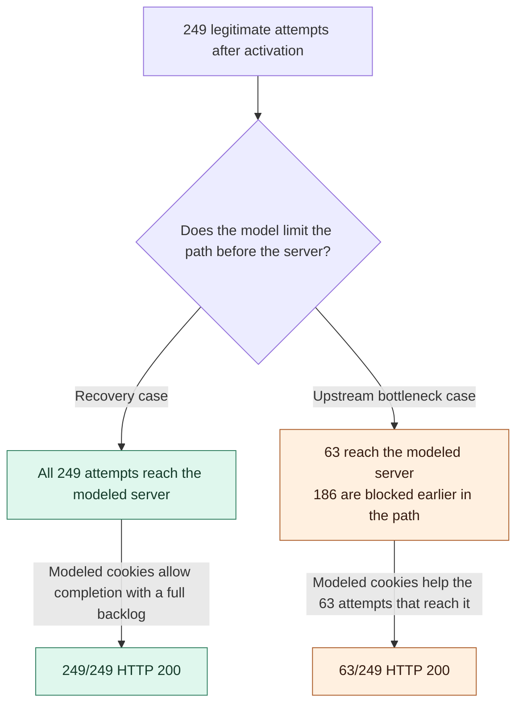
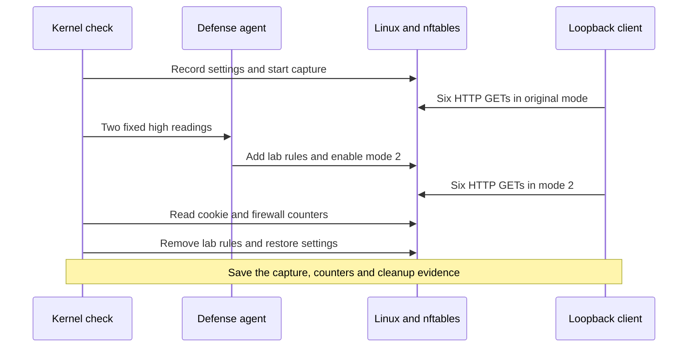
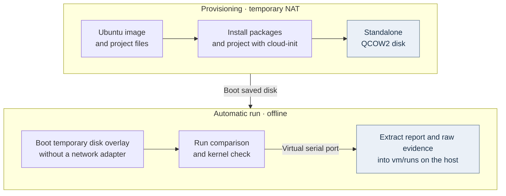

# Project architecture and diagrams

Start with the [system architecture](#system-architecture), then follow the [comparison](#comparison-data-flow) or the [Linux verification](#linux-kernel-verification). The comparison models a SYN flood and measures real localhost HTTP responses. The separate kernel check measures real Linux SYN cookies with benign traffic.

## System architecture

The automatic VM run performs the comparison first, then the kernel check. It packages the evidence from both stages for export to the host.

| Component | Responsibility |
|---|---|
| [VM builder](../vm/build-vm.py) and [guest provisioning](../vm/provision-guest.sh) | Install Ubuntu dependencies and the project into a bootable image. |
| [VM launcher](../vm/run-vm.py) and [demo runner](../demo.py) | Boot the isolated VM, choose a request profile, run the comparison and export the results. |
| [Pressure model](../pressure_model.py) | Represent source grouping, the half-open queue, modeled cookies and the upstream limit. |
| [Defense agent](../syn_defense_agent.py) | Sample half-open occupancy and call the appropriate mitigation backend. |
| [Benchmark](../client_benchmark.py) and [HTTP service](../lab_http.py) | Send ordinary loopback requests and translate model verdicts into HTTP responses. |
| [Kernel verification](../kernel_check.py) and [firewall rules](../firewall_rules.sh) | Exercise real cookies, validate counters, capture benign traffic and restore lab settings. |
| [Report generator](../generate_charts.py) | Build the comparison tables and charts from the recorded CSVs. |

## TCP handshake and flood pressure

The middle branch explains why the simulated attacker can make the service unavailable while completing zero connections. The benchmark counts HTTP requests from the legitimate client. [Attacker team guide](attacker-team.md) · [Defender team guide](defender-team.md)

## Comparison data flow

A `503` represents a modeled rejection. The local client still completed its TCP handshake with the Python service to receive that response. The request profile changes the number of sequential legitimate probes. The modeled flood pressure stays fixed. [Workload results](../evidence/workloads/README.md)

## Per-source filtering

These counts cover all six windows of the 500-request profile. In the changing-source case, the 84 successful probes came from window 1, before pressure started. [500-request summary](../evidence/workloads/500/summary.csv)

## Detector timing

In the 500-request profile, both automated cases sample 32 modeled half-open entries at the end of windows 2 and 3. The detector activates after two consecutive samples at or above 20. Only windows 4–6 contribute to the post-activation denominator of 249. [Agent records](../evidence/workloads/500/agent.csv) · [Window records](../evidence/workloads/500/windows.csv)

## Recovery and the upstream limit

An upstream bottleneck is a capacity limit before the server, such as a saturated link. A SYN cookie protects the server’s half-open state once traffic arrives. The simulated upstream limit remains active in the second branch. [500-request summary](../evidence/workloads/500/summary.csv)

## Linux kernel verification

The runner uses cookie test mode `2` inside the temporary namespace so ordinary connections exercise the mechanism. The recorded VM check shows six cookies sent, six validated and twelve HTTP 200 responses across the two phases. The capture contains only the benign kernel-check traffic. [Kernel counters](../evidence/workloads/500/kernel-check.json) · [Packet capture](../evidence/workloads/500/benign-http.pcap)

## VM build and evidence export

Provisioning uses internet access to install packages. The finished VM runs offline, exports the evidence and shuts down automatically. [Environment team guide](environment-team.md)
